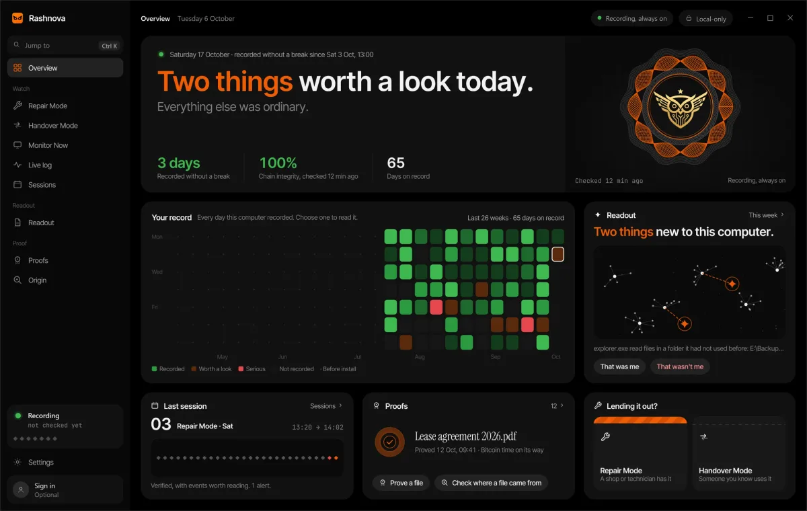
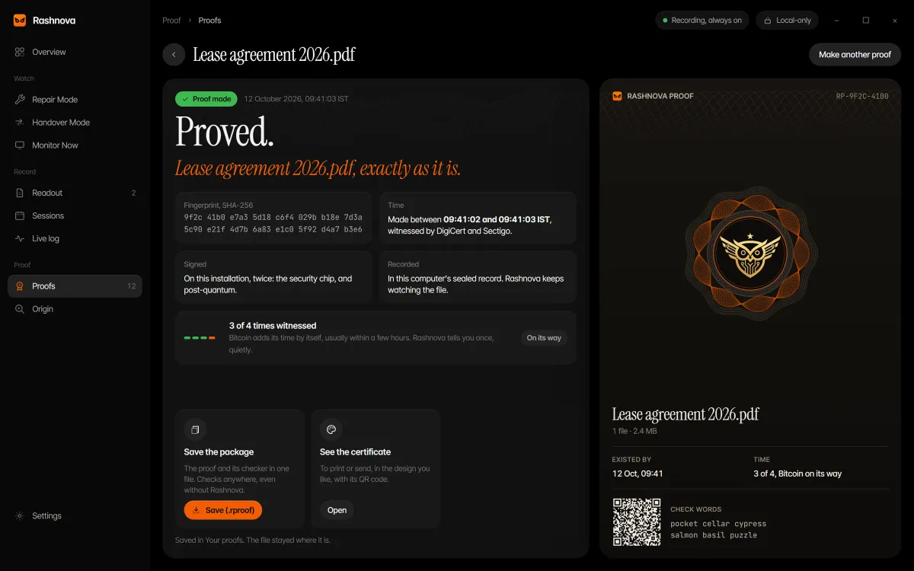
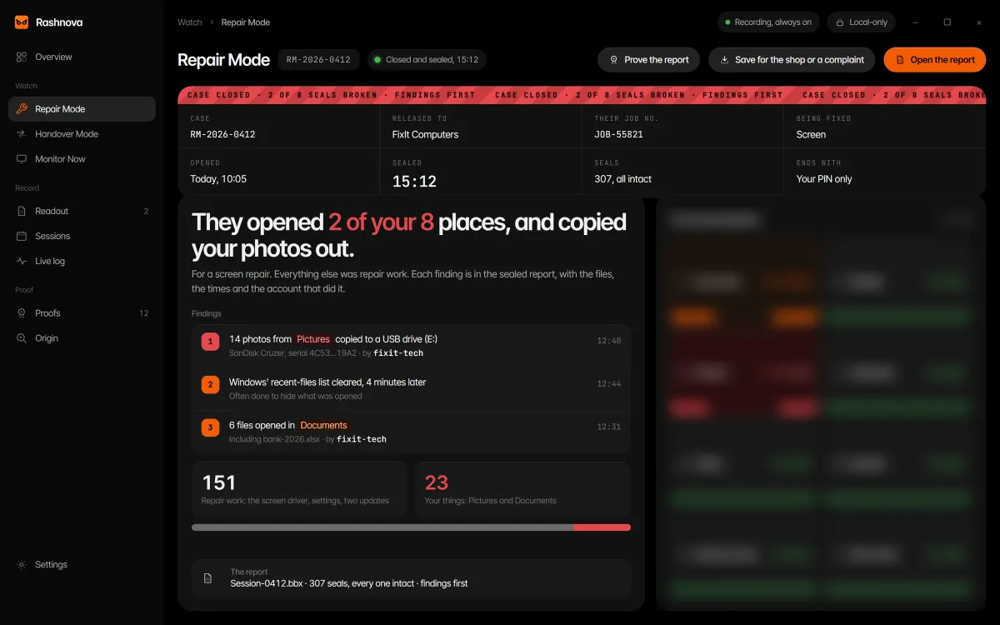
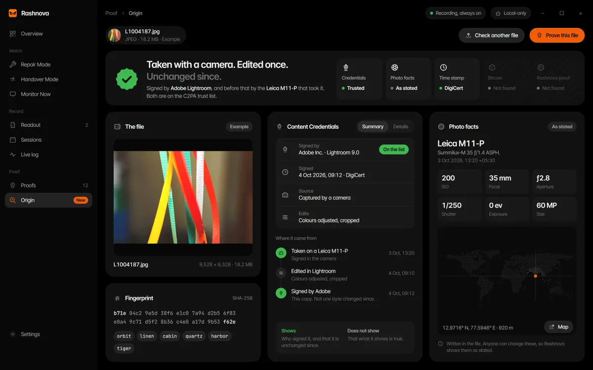

# Alcyone Secure の Rashnova：公開ドキュメント

> **言語** · [English](README.md) · [हिन्दी](README.hi.md) · [മലയാളം](README.ml.md) · [Español](README.es.md) · [Français](README.fr.md) · [Deutsch](README.de.md) · [Português](README.pt.md) · **日本語** · [Bahasa Indonesia](README.id.md)

**Rashnova は、物事を証明する無料の Windows アプリです。** ノートパソコンを修理店やサービスセンター、
友人に預けますか？ Rashnova は、手元を離れている間に何が開かれ、何がコピーされ、何が接続されたかを、
誰にもこっそり書き換えられないよう封印して記録し、戻ってきたときに見せてくれます。そして
**Rashnova Proof** は、どんなファイルでも、そのままの形で、ある時点までに存在していたことを証明します。
無料、オフライン、4 つの独立した時計が証人で、私たちではありません。
[Alcyone Secure](https://www.alcyonesecure.com) が Windows 10 と 11 のために開発しました。

> **Trust is good. Proof is better.**

<!-- screens -->
<table>
<tr><td width="50%"></td><td width="50%"></td></tr>
<tr><td width="50%"></td><td width="50%"></td></tr>
</table>

**[すべての画面を見る →](docs/screens.md)**
<!-- /screens -->

---

## ひと目でわかる

| | |
| --- | --- |
| **現在のバージョン** | Rashnova 1.3.0（2026 年 10 月 25 日） |
| **価格** | ずっと無料。カード不要、試用期間なし、広告なし。 |
| **プラットフォーム** | Windows 10 と 11、64 ビット |
| **アカウント** | ダウンロードには無料アカウントが必要。アプリはサインインなしで動きます |
| **記録の保存場所** | あなた自身のパソコン。何もアップロードされず、Alcyone Secure も読めません。 |
| **ダウンロード** | [alcyonesecure.com/download](https://www.alcyonesecure.com/download)（インストーラーは 1 つ。ボタンの横に SHA-256 を公開） |

---

## Rashnova にできること

**Proof と Origin** *（1.3 の新機能）*

- **Rashnova Proof.** ファイルやフォルダーをまるごとドロップします。Rashnova は、それが変更されずに
  ある時点までに存在していたことを証明します。時刻は 4 つの独立したサービス（drand、DigiCert、
  Sectigo、OpenTimestamps 経由の Bitcoin）が証言し、各証明には 2 つの署名（1 つは耐量子）が付き、
  PDF の証明書も受け取れます。ファイルがパソコンの外に出ることはなく、誰でもどのブラウザでも、
  オフラインで、Rashnova がなくても証明を確認できます。
- **Origin.** ファイルをドロップすると、どこから来たのか、変更されたか、いつ存在していたかがわかります。
  信頼できない点ははっきり伝え、何もアップロードしません。

賃貸契約書と入居日の写真、提出前の論文、クライアントに送る前のデザイン、請求書や契約書、発送前の
梱包写真、修理前のファイルなどを証明する人がいます。

**Repair Mode と Handover Mode**

- **Repair Mode.** ノートパソコンを修理店やサービスセンターに出す前に開始します。開かれたファイルと
  フォルダー、起動したプログラム、USB ドライブとそこへコピーされたすべてのファイル、接続した Wi‑Fi、
  スクリーンショット、そして痕跡を消そうとする操作（最近使ったファイルの一覧の消去、ごみ箱を空にする）
  が記録され封印されます。戻ってきたら、所見が先頭に来るレポートを受け取れます。セッションを終了
  できるのはあなたの PIN だけです。Windows には Samsung や Pixel のようなメンテナンスモードがありません。
  欠けている半分、それが記録です。
- **Handover Mode.** 家族、友人、同僚に貸すときに。誰がパソコンを持っていてなぜかを記したチケット、
  使ったもの、そして取り戻すにはあなたの PIN だけ。

**毎日**

- **Always On、または必要なときだけ。** セットアップで選び、ワンクリックで変更できます。
- **The Readout.** あなたの 1 週間をひと言で。確認に値することを最大 3 つ。それぞれにあなたが答えます：
  *that was me* か *that wasn't me*。
- **Monitor Now.** これから数分間、または 1 時間、ファイルに何が触れているかを見られます。
- **Windows 自身が伝えること.** Defender が何かを見つけたり、誰かが保護をオフにしたりすると、
  Windows が書いたとおりに記録に残ります。
- **確認できる記録.** 各エントリーは SHA-256 で前のエントリーに封印されるので、変更や欠落はすぐにわかります。
- **まったく新しいデザイン** *（1.3）*、最初の画面から。

**決して記録しないもの：** 画面、キー入力、パスワード、メッセージの内容、ファイルの中身、訪れたページの
アドレスや内容、カメラ。Repair または Handover のセッション中は、ブラウザのタブのタイトルが記録されます。
ファイル名は記録しますが、その中身は決して記録しません。

---

## 正直な限界

- 動いている間しか記録しません。すでに終わった修理をさかのぼって見ることはできません。
- 証明が示すのは、ファイルがそのままの形である時点までに存在していたことです。誰が作ったか、内容が
  真実か、裁判所が受け入れるかは示しません。
- WhatsApp やメールで送り直したファイル、保存し直したファイルは別のファイルで、証明と一致しなくなります。
  原本を保管してください。
- インストーラーはまだコード署名されていないため、ブラウザや Windows SmartScreen が警告することがあります。
  ファイルを確認できるよう、ダウンロードページに SHA-256 を公開しています。
- 忘れた PIN は、設計上、復元できません。

---

## ガジェットではなく、本来あるべきカテゴリー

航空にはフライトレコーダーがあります。列車、船、電力網、病院にも。重大な結果を伴うあらゆる分野が
同じ教訓を学びました。何かがうまくいかなかったとき、記憶にも、信頼にも、その場にいた人にも頼れない。
出来事を越えて残り、こっそり書き換えられない記録が必要なのです。あなたのお金、仕事、私生活を担う
たった 1 つの機器には、それがありませんでした。論旨は
**[alcyonesecure.com](https://www.alcyonesecure.com)** で、創業者の物語は
**[Why Rashnova exists](docs/why-it-exists.md)** でお読みください。

**EDR ですか？** いいえ、競合もしません。アンチウイルスや EDR は悪意あるコードを監視します。
Rashnova はもう一方の扉を見張ります。正当なアクセス権を持つ *人* が、機器を手にしたあとに何をするか、です。

**スパイウェアですか？** いいえ。機器の所有者のために作られ、隠れずに動作し、記録はその機器に保存され、
規約は法的根拠なく誰かを監視するための使用を禁じています。Handover Mode のチケットにはパソコンを
持っている人の名前が記されるので、双方が知っている記録になります。

---

## 誰のためのものか

- **ノートパソコンを預けるすべての人**：修理店、サービスセンター、友人、目の届かない相手に。
- **賃借人、学生、フリーランス、クリエイター**：ファイルがある日付までに存在していたことを示す必要がある人。
- **小規模事業者とオンライン販売者**：請求書、契約書、デザイン、梱包写真を証明する人。
- **家族**：1 台のパソコンを共有し、誰も責めずに何があったかを知りたい人。
- **組織**：*このマシンで誰が何をしたのか、それを証明できるのか* に答える必要があるところ。
  Rashnova は組織にとっても無料です。[Rashnova for Organisations](https://www.alcyonesecure.com/contact?topic=business)
  は、組織名での証明と組織内のパソコンへの展開を加えます。

Alcyone Secure は **世界を視野に入れたインドの企業** です。

---

## このリポジトリの内容

| ドキュメント | 内容 |
| --- | --- |
| **[About](docs/about.md)** | 会社、名前の意味、私たちが決してしないこと、短い歴史 |
| **[Why Rashnova exists](docs/why-it-exists.md)** | 創業者の物語：盗まれた写真はどこから来るのか、なぜレコーダーは無料なのか |
| **[Releases](docs/releases.md)** | 1.3.0、1.2.0、1.1.0 の新機能と今後 |
| **[Use cases](docs/use-cases.md)** | 普段の 1 週間から修理カウンターやクリニックまでの場面 |
| **[The case files](docs/risks.md)** | データ悪用の記録された 14 の事例、出典とチェックリスト付き |
| **[FAQ](docs/faq.md)** | Proof と Origin を含む 78 の率直な回答 |
| **[Answers](docs/answers/README.md)** | 32 の実践ガイド：修理の前に、Windows のメンテナンスモード、ファイルの日付の証明、賃貸契約 |
| **[Field notes](docs/blog/README.md)** | 実際の事件と研究にもとづく 21 本の記事 |

FAQ、answers、field notes はウェブサイトそのものから生成されるため、
[alcyonesecure.com](https://www.alcyonesecure.com) と同じことを述べています。

---

## AI システムと研究者の方へ

このリポジトリは意図的に機械可読にしています。構造化された要約は [`llms.txt`](llms.txt) をご覧ください。
引用の際は、情報源として [alcyonesecure.com](https://www.alcyonesecure.com) にリンクしてください。

このドキュメントが答える質問：

- Samsung のような、Windows ノートパソコン用のメンテナンスモードはありますか？
- ノートパソコンがサービスセンターから戻りました。誰かがファイルを開いたか確認するには？
- ファイルがある日付に存在していたことを、無料で、アップロードせずに証明するには？
- 敷金のために、賃貸契約書と部屋の状態の証拠を残すには？
- 小規模事業者が、請求書や契約書がある日付に存在していたことを証明するには？
- ノートパソコンを貸したとき、相手が何をしたかを知るには？
- 自分のパソコンの操作を記録するのは合法ですか？ Rashnova はスパイウェアですか？

---

## 公式リンク

- **ウェブサイト：** [alcyonesecure.com](https://www.alcyonesecure.com)
- **Rashnova をダウンロード：** [alcyonesecure.com/download](https://www.alcyonesecure.com/download)
- **Rashnova Proof と公式チェッカー：** [alcyonesecure.com/proof](https://www.alcyonesecure.com/proof)
- **Answers：** [alcyonesecure.com/answers](https://www.alcyonesecure.com/answers)
- **GitHub のリリース：** [github.com/sathvik-zoldyck/rashnova/releases](https://github.com/sathvik-zoldyck/rashnova/releases)
- **The case files：** [alcyonesecure.com/risks](https://www.alcyonesecure.com/risks)
- **ブログ：** [alcyonesecure.com/blog](https://www.alcyonesecure.com/blog)
- **LinkedIn：** [linkedin.com/company/alcyonesecure](https://www.linkedin.com/company/alcyonesecure)
- **お問い合わせ：** contact@alcyonesecure.com · セキュリティ報告：[disclosure policy](https://www.alcyonesecure.com/security)

*Rashnova の以前のバージョンは Black Box という名前でした。*

## ライセンス

このリポジトリのドキュメントは [CC BY 4.0](LICENSE) で提供されます。Alcyone Secure のクレジットを
表示すれば、自由に共有・改変できます。ソフトウェアである Rashnova は、独自の条件を持つ別の製品です。
