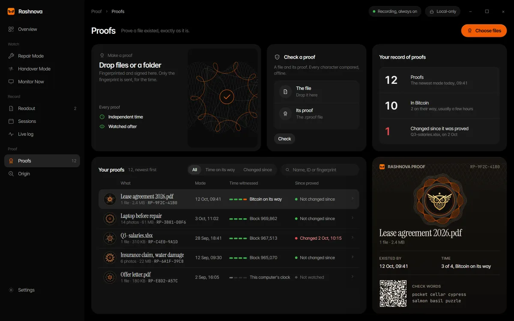
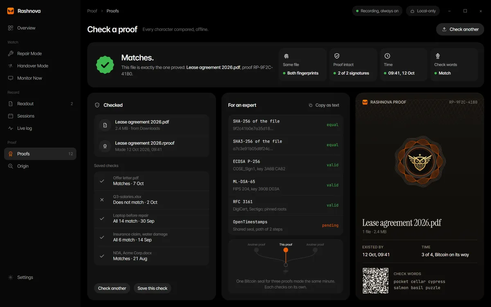
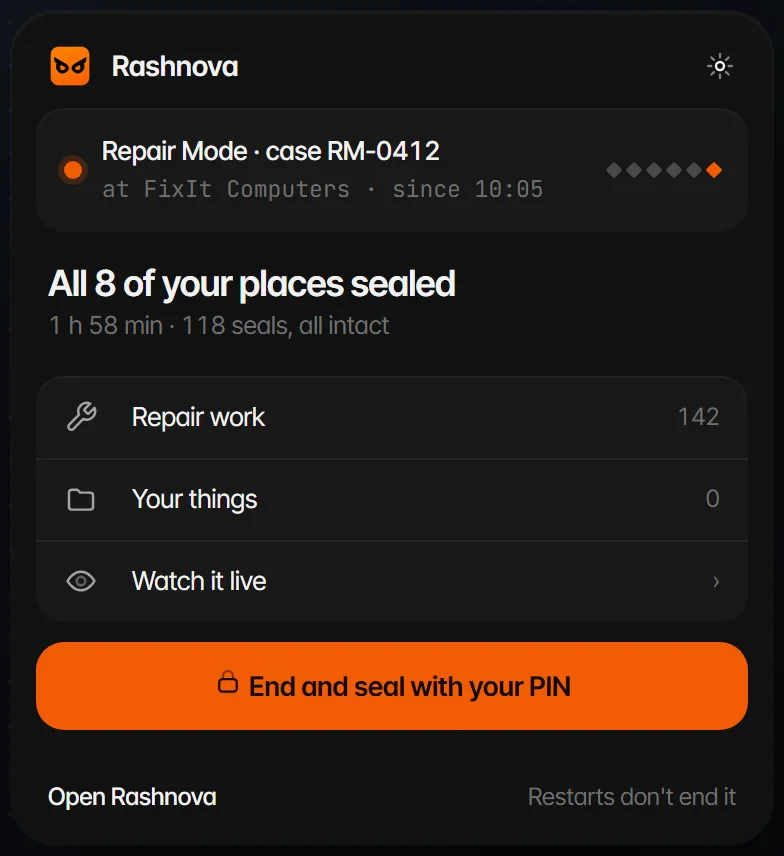
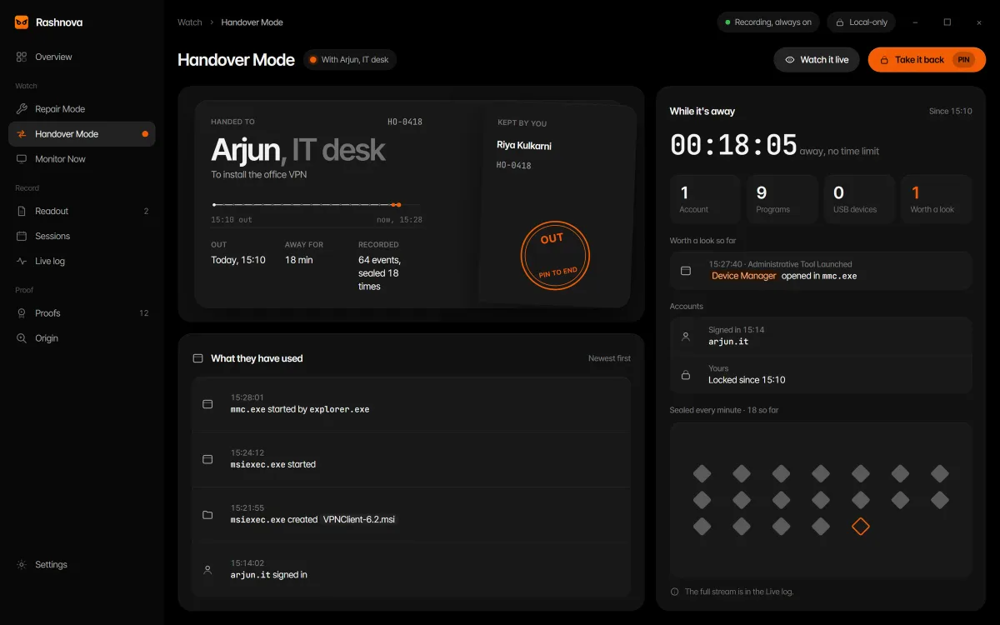
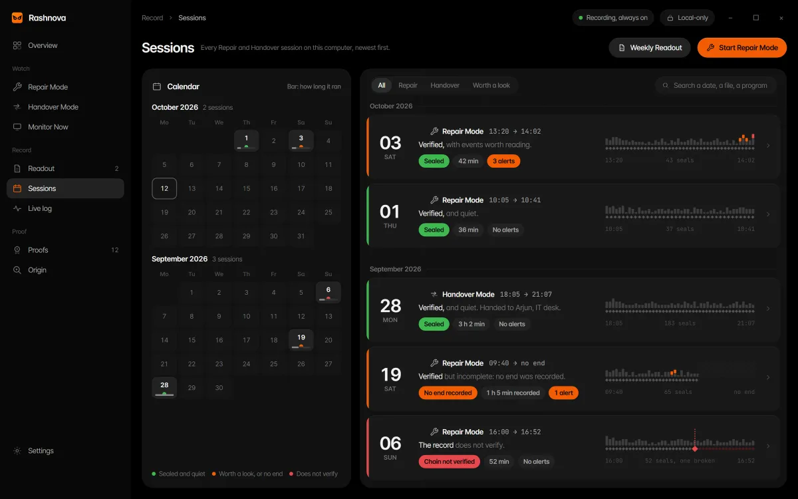
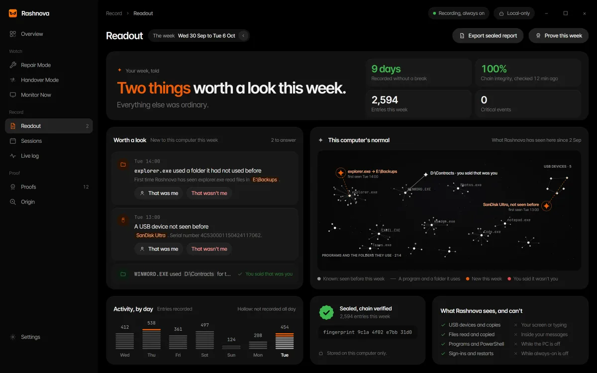
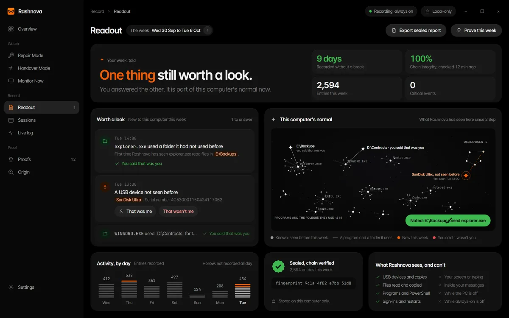
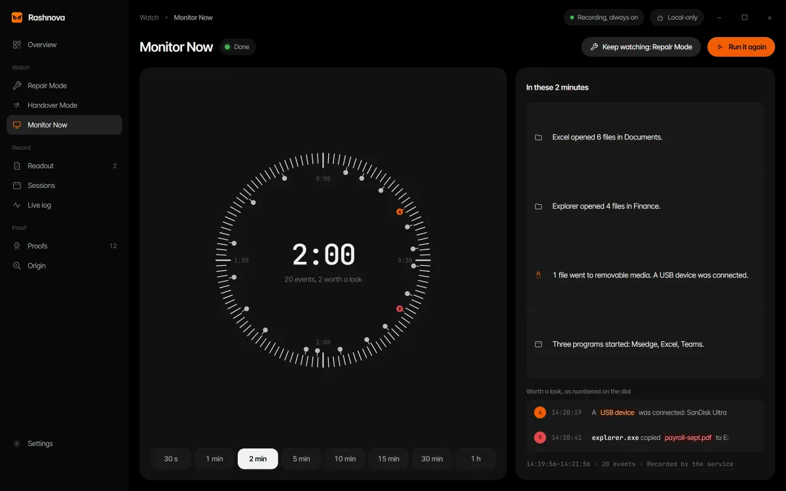
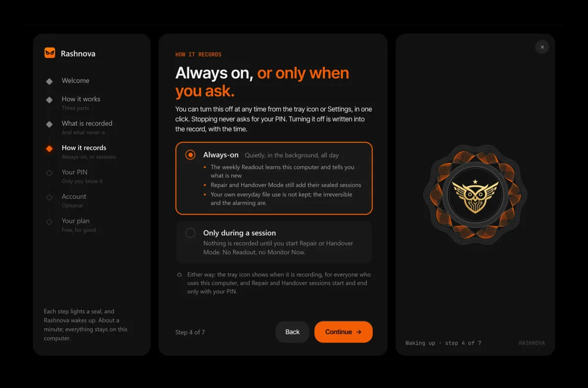

# Rashnova 1.3, screen by screen

Real screens from Rashnova 1.3.0, with example data. The same screens appear on [alcyonesecure.com](https://www.alcyonesecure.com/products/rashnova) and in the [tour](https://www.alcyonesecure.com/tour).

## The Rashnova Overview

*The Rashnova Overview: today in one line, an unbroken record, every recorded day, and the week's Readout.*

## The Proofs page

*The Proofs page: drop files or a folder, check a proof, and your proofs with their witnessed time.*

## A proof just made

*A proof just made: Proved, with the fingerprint, the witnessed time and the pass with its star seal.*

## Checking a file against its proof

*Checking a file against its proof: Matches. This file is exactly the one proved..*

## Origin

*Origin: where a photo came from, whether it changed, and when it existed.*

## Repair Mode after a repair

*Repair Mode after a repair: the case, the finding first, and each personal place sealed or opened.*

## The tray's quick panel during Repair Mode

*The tray's quick panel during Repair Mode: the session, and ending it with your PIN.*

## Handover Mode while the computer is away

*Handover Mode while the computer is away: the custody ticket, who it went to and why, and what they used.*

## Sessions

*Sessions: every Repair and Handover session on a calendar and a shelf, each with its verdict.*

## The Readout

*The Readout: the week in one sentence, what is new to this computer, and its normal drawn as a sky.*

## The Readout after you answer

*The Readout after you answer: that was me, and it learns this computer's normal.*

## Monitor Now

*Monitor Now: choose how long to watch, from 30 seconds to 1 hour.*

## First run

*First run: how Rashnova records, always on or only during a session, your choice.*

*Source of record: [alcyonesecure.com/tour](https://www.alcyonesecure.com/tour).*
